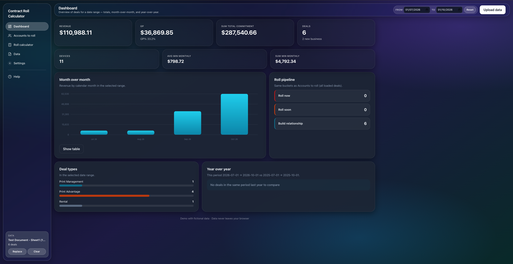
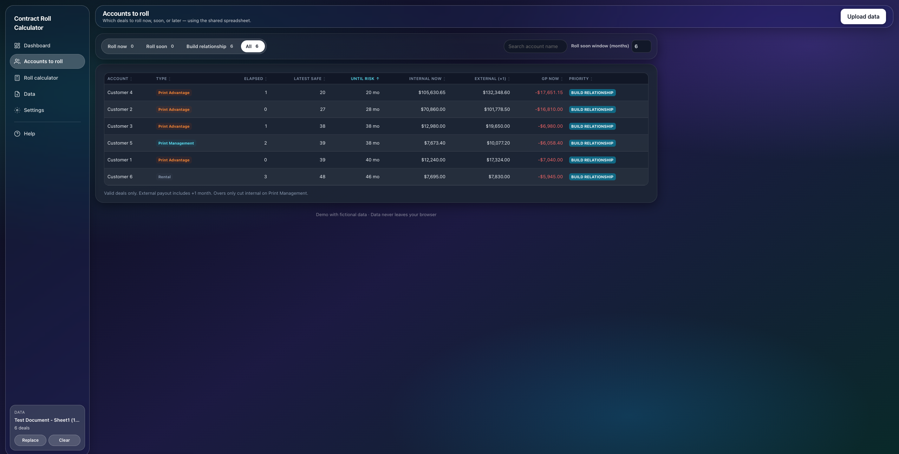
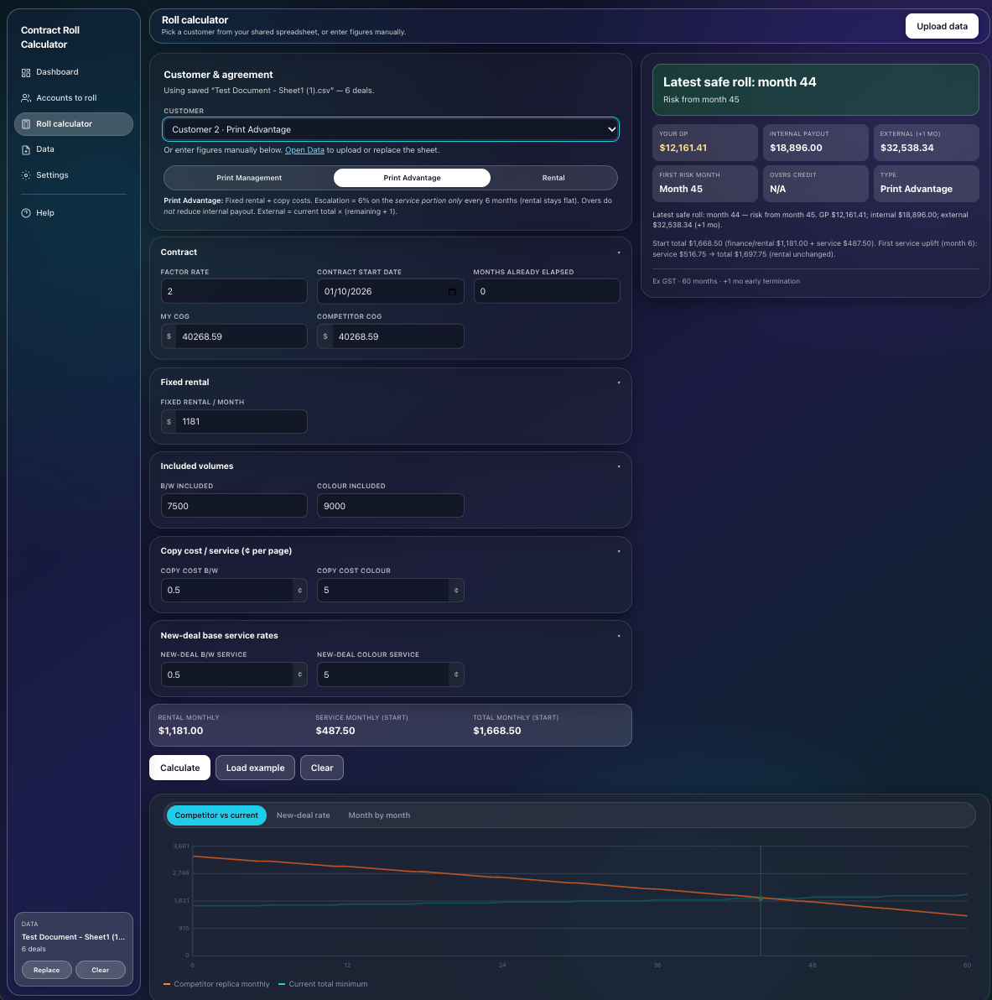

# Contract Roll Calculator

**Tells a managed print sales rep exactly when to re-sign each customer: late enough to protect margin, early enough to beat a competitor buyout.**

**[Live demo →](https://jimmymoloney.github.io/contract-roll-calculator/)** · Click **Load sample data** to try it with fictional customers.

## The problem

In managed print, customers sit on 60-month contracts. Re-sign ("roll") a customer too early and the payout on their remaining term eats your gross profit. Leave it too late and a competitor can afford to buy out the contract and take the account.

I was working this out by hand with spreadsheets, one customer at a time. So I built a tool to do it across the whole book.

## What it does

- **Dashboard:** revenue, GP, contract value and deal trends for any date range, plus a roll pipeline.
- **Accounts to roll:** every customer sorted into **Roll now**, **Roll soon** or **Build relationship**, based on when a competitor's offer would beat their current contract.
- **Roll calculator:** models one customer month by month and shows the **latest safe month to roll**, the GP available, and the internal and external payout.
- **Settings:** contract term, escalation and payout rules are all editable, so it adapts to different contract structures.

## Privacy by design

Customer data never leaves your computer. The spreadsheet is read and processed entirely in the browser. There is no server, no tracking and no external requests, and it works offline.

## How I built it

I'm a sales rep, not a developer. I had no coding background when I started. I built this in Cursor by describing what I needed in plain English, testing each version against my own manual calculations, and iterating: first the calculator logic, then the multi-page app, then a full design pass.

What I learned: the hard part wasn't the code. It was defining the business rules precisely enough for the AI to get them right, then checking its work.

## Tech

Plain HTML, CSS and JavaScript · [SheetJS](https://sheetjs.com) for reading Excel/CSV · hosted on GitHub Pages.

## Run it locally

Download or clone this repo and open `index.html` in Chrome. No install needed.

---

*Demo uses fictional data. Built by James Moloney · [LinkedIn](https://www.linkedin.com/in/james-moloney-85b19a160)*
